# Technical Methodology: Semi-Supervised Action Recognition with FixMatch & $F^2$-FixMatch

## 1. Executive Summary & Problem Formulation

Video action recognition requires extracting dynamic spatial and temporal features across sequential video frames. While collecting unlabeled video is inexpensive, annotating temporal boundaries and action labels is prohibitively labor-intensive. 

> **Problem Statement (P24)**: Given the UCF-101 benchmark with 101 human action categories, learn a high-accuracy video classifier using strictly **10% labeled training videos** (953 labeled videos, ~9.4 videos/class) and **90% unlabeled videos** (8,584 unlabeled videos), closing the performance gap toward full supervision (9,537 labeled videos).

To systematically evaluate the benefit of unlabeled video data, this repository formulates and reproduces three core tiers alongside an oracle upper bound:

1. **Supervised Baseline (10% Labels Only)**: Trained exclusively on the 953 labeled videos with standard cross-entropy loss, establishing the lower-bound reference.
2. **FixMatch Baseline (Single-Stream RGB)**: Adapts consistency-based pseudo-labeling (Sohn et al., NeurIPS 2020) to 3D video recognition using weak-to-strong spatial augmentations (RandAugment + Cutout) and confidence thresholding ($\tau = 0.3$).
3. **$F^2$-FixMatch (Full Framework)**: State-of-the-art semi-supervised video framework (Tu et al., ACM TOMM 2025) integrating bi-modal representations (RGB + dynamic Temporal Gradient), **Progressive Augmentation (P-Aug)** across frame and feature spaces, and **Multihead Pseudo-Labeling (MPL)** with decoupled classification heads.
4. **Supervised Upper Bound (Oracle, 100% Labels)**: Full-supervision ceiling trained across all 9,537 annotated videos.

---

## 2. Theoretical Formulation & Method Distinction

A critical methodological distinction must be made between standard FixMatch and $F^2$-FixMatch:

```mermaid
flowchart TD
    subgraph Single_Stream["FixMatch Baseline (RGB Single-Stream)"]
        InRGB1["Unlabeled Video Clip (x_V)"]
        WeakAug1["Weak Spatial Aug (A_w)"]
        StrongAug1["Strong Spatial Aug (A_s)"]
        Enc1["3D-ResNet-18 Backbone"]
        Head1["Single 3D Classifier Head (C_3D)"]
        Mask1["Confidence Threshold (tau=0.3)"]
        Loss1["Consistency Loss: L_u = m * CE(p_s, y_hat)"]
        
        InRGB1 --> WeakAug1 & StrongAug1
        WeakAug1 --> Enc1 --> Head1 --> Mask1
        StrongAug1 --> Enc1 --> Head1
        Mask1 & Head1 --> Loss1
    end

    subgraph Bi_Modal["F²-FixMatch (Bi-Modal RGB + TG + Progressive Augmentation)"]
        InRGB2["RGB Video Clip (x_V)"]
        InTG2["Temporal Gradient (x_G)<br/>x_t^G = (x_t^V - x_{t+1}^V + 255) / 2"]
        PAugFrame["Frame-Level Progressive Aug (Z_w, Z_s)"]
        Enc2["Shared 3D-ResNet-18 Backbone"]
        PAugFeat["Feature-Level Perturbations (P-Aug)<br/>TAP + Dropout + HFlip + CutMix"]
        Head3D["3D Head (C_3D)<br/>Generates Pseudo-Labels"]
        HeadTAP["TAP Head (C_TAP)<br/>Supervised by 3D Head"]
        MPLLoss["Multihead Loss: L = L_s + alpha*L_u^s + beta*L_u^{w_p} + gamma*L_u^{s_p}"]

        InRGB2 & InTG2 --> PAugFrame --> Enc2 --> PAugFeat
        Enc2 --> Head3D
        PAugFeat --> HeadTAP
        Head3D & HeadTAP --> MPLLoss
    end
```

### 2.1 Why $F^2$-FixMatch is Not Merely an "Augmentation Ablation"
In early project drafts, $F^2$-FixMatch was occasionally mislabeled as an "augmentation ablation" of FixMatch. Methodologically, $F^2$-FixMatch introduces four fundamental components absent from standard FixMatch:
* **Dynamic Temporal Gradient Modality**: Injects explicit frame differences $x^G$ alongside RGB $x^V$ to provide appearance-invariant velocity fields without requiring optical flow precomputation.
* **Feature-Level Perturbation**: Injects perturbations directly into the intermediate latent representation space $\mathcal{Z} \in \mathbb{R}^{B \times 512 \times 8 \times 7 \times 7}$.
* **Decoupled Classification Heads**: Employs two distinct heads: a Spatio-Temporal Head $C_{3D}$ and a Temporal Average Pooling Head $C_{TAP}$.
* **Multihead Pseudo-Labeling (MPL)**: The 3D head supervises both the frame-level strongly augmented views and the feature-perturbed views through separate loss terms.

---

## 3. Mathematical Formulation

### 3.1 Input Modalities & Sampling
Let an input video be represented as a sequence of frames. A clip consists of $T=8$ frames sampled with a temporal stride of $s=8$ (covering a span of 64 raw video frames):

1. **RGB Appearance Stream ($x^V$):**
   $$x^V = \{x_1^V, x_2^V, \dots, x_T^V\} \in \mathbb{R}^{3 \times T \times H \times W}$$

2. **Temporal Gradient Dynamic Stream ($x^G$):**
   Temporal gradients capture instantaneous velocity without the multi-gigabyte storage cost of Farnebäck or TV-L1 optical flow:
   $$x_t^G = \frac{x_t^V - x_{t+1}^V + 255}{2}, \quad t \in \{1, 2, \dots, T\}$$
   Both modalities share the exact same spatial dimensions ($H \times W = 224 \times 224$) and are processed by a single shared 3D-ResNet-18 backbone.

---

### 3.2 Progressive Augmentation (P-Aug)

Progressive Augmentation applies perturbations in two cascading stages:

#### Stage 1: Frame-Level Progressive Augmentation
* **Weak Augmentation ($A_w$):** Standard scale-preserving RandomResizedCrop (scale $[0.8, 1.0]$, size $224 \times 224$) and horizontal flip with probability $p=0.5$.
* **Strong Augmentation ($A_s$):** Weak augmentation followed by **Video RandAugment** (sampled across 13 temporal operations with magnitude $M=10$) and **Video Cutout** ($128 \times 128$ rectangular spatial masking applied consistently across all $T$ frames).

#### Stage 2: Feature-Level Progressive Perturbation
Let $Z = E(x) \in \mathbb{R}^{B \times 512 \times 8 \times 7 \times 7}$ denote the feature representation extracted by the shared 3D encoder before global pooling. Four perturbations are applied:
1. **Temporal Average Pooling (TAP):**
   $$\text{TAP}(Z) = \frac{1}{T} \sum_{t=1}^T Z_{:, :, t, :, :} \in \mathbb{R}^{B \times 512 \times 7 \times 7}$$
2. **Spatial Feature Dropout:** Randomly drops feature activations with probability $p=0.5$.
3. **Feature Horizontal Flip:** Horizontally mirrors feature maps with probability $p=0.5$.
4. **Feature CutMix:** Swaps random rectangular feature patches across batch samples with probability $p=0.5$:
   $$\widetilde{Z} = M_{\text{feat}} \odot Z_i + (1 - M_{\text{feat}}) \odot Z_j$$

Applying these operations produces four distinct representations for every unlabeled video:
* $Z_w$: Frame-weak feature (unperturbed)
* $Z_s$: Frame-strong feature
* $Z_{w_p}$: Frame-weak feature with feature perturbation
* $Z_{s_p}$: Frame-strong feature with feature perturbation

---

### 3.3 Multihead Pseudo-Labeling (MPL) & Decoupled Heads

To prevent self-reinforcing weight collapse, $F^2$-FixMatch decouples the classifier into:
* **3D Spatio-Temporal Head ($C_{3D}$):** `AdaptiveAvgPool3d((1,1,1)) -> Linear(512, 101)`. Evaluates $Z_w$ and $Z_s$.
* **TAP 2D Head ($C_{TAP}$):** `AdaptiveAvgPool2d((1,1)) -> Linear(512, 101)`. Evaluates $Z_{w_p}$ and $Z_{s_p}$.

#### Pseudo-Label Generation
The pseudo-label $\hat{y}$ is generated **exclusively** from the weakly augmented RGB and TG views through the 3D head:
$$p_w = \operatorname{softmax}\left(C_{3D}(Z_w)\right)$$
$$\hat{y} = \arg\max_c p_w(c), \qquad q = \max_c p_w(c)$$

The confidence mask selects samples meeting threshold $\tau = 0.3$:
$$m = \mathbb{1}[q \geq \tau]$$

> **Design Rationale**: Feature-perturbed views ($Z_{w_p}, Z_{s_p}$) are evaluated exclusively by $C_{TAP}$ and are **never** used to generate pseudo-labels. This strict structural firewall guarantees that aggressive feature corruptions cannot poison the pseudo-label generator.

---

### 3.4 Multi-Task Objective Function

The joint loss across labeled batch $\mathcal{B}_l$ and unlabeled batch $\mathcal{B}_u$ is defined as:
$$\mathcal{L} = \mathcal{L}_s + \alpha \mathcal{L}_u^s + \beta \mathcal{L}_u^{w_p} + \gamma \mathcal{L}_u^{s_p}$$

1. **Supervised Loss ($\mathcal{L}_s$):**
   $$\mathcal{L}_s = \frac{1}{|\mathcal{B}_l|} \sum_{i \in \mathcal{B}_l} \text{CE}\left(C_{3D}(E(x_i)), y_i\right)$$

2. **Frame-Level Strong Consistency Loss ($\mathcal{L}_u^s$):**
   Supervises the frame-strongly augmented view through the 3D head:
   $$\mathcal{L}_u^s = \frac{1}{|\mathcal{B}_u|} \sum_{j \in \mathcal{B}_u} m_j \cdot \text{CE}\left(C_{3D}(Z_{s, j}), \hat{y}_j\right)$$

3. **Feature-Perturbed Weak TAP Loss ($\mathcal{L}_u^{w_p}$):**
   Supervises the weakly augmented feature-perturbed view through the TAP head:
   $$\mathcal{L}_u^{w_p} = \frac{1}{|\mathcal{B}_u|} \sum_{j \in \mathcal{B}_u} m_j \cdot \text{CE}\left(C_{TAP}(Z_{w_p, j}), \hat{y}_j\right)$$

4. **Feature-Perturbed Strong TAP Loss ($\mathcal{L}_u^{s_p}$):**
   Supervises the strongly augmented feature-perturbed view through the TAP head:
   $$\mathcal{L}_u^{s_p} = \frac{1}{|\mathcal{B}_u|} \sum_{j \in \mathcal{B}_u} m_j \cdot \text{CE}\left(C_{TAP}(Z_{s_p, j}), \hat{y}_j\right)$$

Hyperparameters follow the official paper specification: $\alpha = 2.0$, $\beta = 2.0$, $\gamma = 1.0$, and $\tau = 0.3$.

---

## 4. Network Architecture: 3D-ResNet-18

The backbone is an inflated 3D-ResNet-18 (31.92M parameters) adhering strictly to Table 2 of Tu et al. (2025):

| Stage | Layer Configuration | Output Spatial Dim | Output Channels | Temporal Dim ($T$) |
| :--- | :--- | :---: | :---: | :---: |
| **Input** | Raw video clip / Temporal Gradient | $224 \times 224$ | 3 | 8 |
| **conv1** | $1 \times 7 \times 7$, spatial stride 2 | $112 \times 112$ | 64 | 8 |
| **pool1** | $1 \times 3 \times 3$ max pool, spatial stride 2 | $56 \times 56$ | 64 | 8 |
| **res2** | 2 blocks: $[1 \times 3 \times 3, 64]$ | $56 \times 56$ | 64 | 8 |
| **res3** | 2 blocks: $[1 \times 3 \times 3, 128]$, spatial stride 2 | $28 \times 28$ | 128 | 8 |
| **res4** | 2 blocks: $[3 \times 3 \times 3, 256]$ (inflated), spatial stride 2 | $14 \times 14$ | 256 | 8 |
| **res5** | 2 blocks: $[3 \times 3 \times 3, 512]$ (inflated), spatial stride 2 | $7 \times 7$ | 512 | 8 |
| **Head $C_{3D}$** | `AdaptiveAvgPool3d((1,1,1)) -> Dropout(0.5) -> Linear(512, 101)` | $1 \times 1$ | 101 | 1 |
| **Head $C_{TAP}$** | `AdaptiveAvgPool2d((1,1)) -> Dropout(0.5) -> Linear(512, 101)` | $1 \times 1$ | 101 | 1 |

*Crucial Design Feature*: No temporal pooling or temporal stride is applied anywhere in the backbone; temporal length $T=8$ is preserved throughout all residual stages.

---

## 5. Training Schedules & Progressive Ramp-Up

Training is partitioned into three distinct phases across 220 epochs:

1. **Supervised Warmup (Epochs 1–40):**
   * Unsupervised weights set to zero: $\alpha = 0, \beta = 0, \gamma = 0$.
   * Backbone and $C_{3D}$ head train strictly on the 10% labeled data ($L_s$).
   * Enables the encoder to learn stable preliminary class cluster centers.
2. **Progressive Ramp-Up (Epochs 41–70):**
   * Unsupervised loss weights scale linearly from 0.0 to their full values ($\alpha \to 2.0$, $\beta \to 2.0$, $\gamma \to 1.0$).
   * Pseudo-label mask coverage expands smoothly from 13.6% to 75.2% without shocking BatchNorm statistics.
3. **Joint Semi-Supervised Convergence (Epochs 71–220):**
   * All four loss terms operate at full weight.
   * Cosine annealing learning rate schedule decays $\eta$ from 0.2 down to $10^{-4}$.

---

## 6. Official Evaluation Protocol (30-View Multi-Crop)

To prevent evaluation bias, testing strictly follows Section 4.2 of Tu et al. (2025):
* **Temporal Sampling:** 10 uniform clips sampled along the entire duration of the video.
* **Spatial Cropping:** 3 crops per clip (left/top, center, right/bottom) scaled to shorter side 256 and cropped to $256 \times 256$.
* **Total Views per Video:** $10 \text{ temporal} \times 3 \text{ spatial} = \mathbf{30 \text{ views}}$.
* **Video Prediction:** Softmax probabilities are averaged across all 30 views:
  $$P(y = c \mid V) = \frac{1}{30} \sum_{k=1}^{30} \operatorname{softmax}\left(f_\theta(v_k)\right)_c$$
* Total validation clips processed: $3,783 \text{ videos} \times 30 = \mathbf{113,490 \text{ clips}}$ per evaluated checkpoint.
