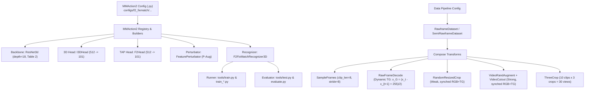
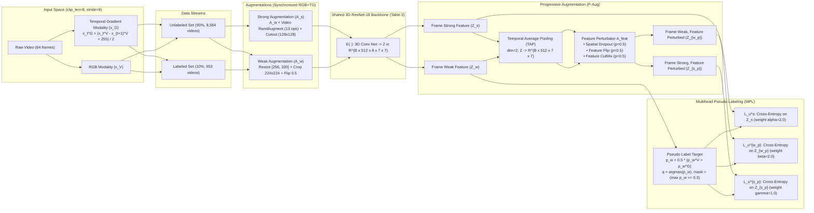

# Technical Methodology: Semi-Supervised Action Recognition with FixMatch and $F^2$-FixMatch in MMAction2

## 1. Executive Summary & Problem Formulation

Video annotation is significantly more labor-intensive and costly than static image annotation, requiring temporal boundary localization and dynamic action tagging across dozens of frames per second. Unlabeled video data, by contrast, is abundant and cheap to acquire.

> **Problem Statement**: Train an accurate action recognition classifier on UCF-101 using only **10% of annotations** (953 labeled videos, 8,584 unlabeled videos) by leveraging consistency-based pseudo-labeling, spatio-temporal modality fusion, and progressive multi-level perturbations.

To establish scientific validation, this repository benchmarks four distinct tiers on UCF-101 (Split 1):
1. **Supervised Baseline (10% Labels Only)**: Trained exclusively on the 953 annotated videos with cross-entropy loss.
2. **FixMatch Baseline**: Adapting image FixMatch (Sohn et al., NeurIPS 2020) to video using weak-to-strong spatial augmentations (RandAugment + Cutout) and confidence thresholding ($\tau = 0.3$).
3. **$F^2$-FixMatch (Full Framework)**: The state-of-the-art framework (Tu et al., ACM TOMM 2025) introducing bi-modal inputs (RGB + dynamic Temporal Gradient), **Progressive Augmentation (P-Aug)** across frame and feature spaces, and **Multihead Pseudo-Labeling (MPL)**.
4. **Supervised Upper Bound (Oracle, 100% Labels)**: Theoretical performance ceiling trained on all 9,537 videos.

---

## 2. MMAction2 Modular Framework Architecture

Following Section 4.2 of Tu et al. (*"we adopt the FixMatch algorithm as the base semi-supervised learning framework and implement $F^2$-FixMatch upon MMaction2"*), the repository is organized into the modular **MMAction2** framework with a native pure-PyTorch registration engine:

### Module Structure
* **`mmaction/models/`**:
  * `backbones/resnet3d.py`: 3D-ResNet-18 backbone matching Table 2 (31.87M parameters).
  * `heads/i3d_head.py`: 3D spatio-temporal classification head (`I3DHead`).
  * `heads/f2_head.py`: 2D temporal-average-pooled classification head (`F2Head`).
  * `perturbator/paug.py`: Progressive feature perturbator (`FeaturePerturbator`) implementing TAP, spatial dropout ($p=0.5$), feature horizontal flip ($p=0.5$), and feature CutMix ($p=0.5$).
  * `recognizers/`:
    * `recognizer3d.py`: Supervised 3D action recognizer (`Recognizer3D`).
    * `fixmatch_recognizer.py`: FixMatch recognizer (`FixMatchRecognizer3D`) with joint batch forward pass for unified BatchNorm tracking.
    * `f2_fixmatch_recognizer.py`: Full $F^2$-FixMatch recognizer (`F2FixMatchRecognizer3D`) with bi-modal encoder, P-Aug, and Multihead Pseudo-Labeling.
* **`mmaction/datasets/`**:
  * `pipelines/`: Modular transforms matching MMAction2 (`SampleFrames`, `RawFrameDecode`, `RandomResizedCrop`, `CenterCrop`, `VideoRandAugment`, `VideoCutout`, `ThreeCrop`, `Normalize`, `FormatShape`, `Collect`).
  * `rawframe_dataset.py`: `RawframeDataset` for labeled training and validation splits.
  * `semi_dataset.py`: `SemiRawframeDataset` producing synchronized weak and strong views across RGB and Temporal Gradient modalities.
* **`configs/`**: MMAction2 standard Python configuration files for Supervised, FixMatch, and $F^2$-FixMatch.
* **`tools/`**: MMAction2 training (`tools/train.py`) and 30-view multi-crop testing (`tools/test.py`) entry points.

---

## 3. End-to-End System & Algorithmic Formulation

### 3.1 Bi-Modal Inputs & Dynamic Temporal Gradients
RGB data captures static appearance, while Temporal Gradient (TG) data explicitly isolates motion dynamics without requiring costly optical flow pre-computation. For adjacent frames $x_t^V$ and $x_{t+1}^V$:
$$x_t^G = \frac{x_t^V - x_{t+1}^V + 255}{2}, \quad x_t^G \in [0, 255]$$

### 3.2 Progressive Augmentation (P-Aug)
Standard video augmentation operates solely at the frame level, where spatial perturbations can be offset by adjacent contextual frames. P-Aug applies progressive perturbations across both frame and latent feature representations:
1. **Frame-Level Weak Augmentation ($A_w$)**: Resize shorter side to $[256, 320]$, random crop $224 \times 224$, horizontal flip with probability $0.5$.
2. **Frame-Level Strong Augmentation ($A_s$)**: Applies $A_w$, followed by Video RandAugment (2 sampled operations from 13 transforms with uniform $\pm$ directional signs) and Video Cutout (masking a $128 \times 128$ square patch across all frames).
3. **Feature-Level Perturbation ($A_{feat}$)**:
   * **Temporal-Average-Pooling (TAP)**: Averages 3D feature $Z \in \mathbb{R}^{B \times 512 \times T \times H \times W}$ along the temporal dimension $T$, producing $Z_{TAP} \in \mathbb{R}^{B \times 512 \times H \times W}$.
   * **Spatial Dropout ($p = 0.5$)**: Randomly zeroes feature activations across the 2D spatial grid.
   * **Feature Horizontal Flip ($p = 0.5$)**: Randomly mirrors features along the horizontal spatial axis.
   * **Feature CutMix / Noise Injection ($p = 0.5$)**: Randomly pastes a spatial patch from another sample in the batch into the target sample feature map.

This produces 4 complementary feature representations for each modality:
$$Z_w = E(A_w(x)), \quad Z_s = E(A_s(x))$$
$$Z_{w\_p} = A_{feat}(\text{TAP}(Z_w)), \quad Z_{s\_p} = A_{feat}(\text{TAP}(Z_s))$$

### 3.3 Multihead Pseudo-Labeling (MPL)
Predictions from the weakly augmented RGB and TG features are aggregated to generate a confident pseudo-label target:
$$\bar{p}_w = \frac{1}{2} \left( \text{Softmax}(C_{3D}(Z_w^V)) + \text{Softmax}(C_{3D}(Z_w^G)) \right)$$
$$q = \arg\max \bar{p}_w, \quad \mathbb{I}(\max \bar{p}_w \ge \tau) \quad (\tau = 0.3)$$

MPL enforces consistency by driving all three perturbed predictions to align with the pseudo-label $q$:
* Frame-level strong loss: $\mathcal{L}_u^s$ (weight $\alpha = 2.0$, evaluated with $C_{3D}$)
* Frame-weak, feature-perturbed loss: $\mathcal{L}_u^{w\_p}$ (weight $\beta = 2.0$, evaluated with $C_{TAP}$)
* Frame-strong, feature-perturbed loss: $\mathcal{L}_u^{s\_p}$ (weight $\gamma = 1.0$, evaluated with $C_{TAP}$)

Supervised loss (Section 3.5, Equation 13) is the unweighted sum across both RGB ($V$) and Temporal Gradient ($G$) modalities:
$$\mathcal{L}_s = \mathcal{L}_s^V + \mathcal{L}_s^G = \text{CE}(C_{3D}(Z_l^V), y) + \text{CE}(C_{3D}(Z_l^G), y)$$

Total objective function:
$$\mathcal{L} = \mathcal{L}_s + \alpha \mathcal{L}_u^s + \beta \mathcal{L}_u^{w\_p} + \gamma \mathcal{L}_u^{s\_p}$$

---

## 4. 3D-ResNet-18 Backbone Configuration (Table 2)

The 3D-ResNet-18 backbone adopts inflated spatio-temporal convolutions matching Table 2 in Tu et al. (31.87M parameters):

| Stage | Layer Specification | Output Dimensions | Stride |
| :--- | :--- | :---: | :---: |
| **Input** | Raw video clip (8 frames) | $3 \times 8 \times 224 \times 224$ | — |
| **conv1** | $1 \times 7 \times 7, 64$ | $64 \times 8 \times 112 \times 112$ | $(1, 2, 2)$ |
| **pool1** | $1 \times 3 \times 3$ max pool | $64 \times 8 \times 56 \times 56$ | $(1, 2, 2)$ |
| **res2** | $\begin{bmatrix} 1 \times 3 \times 3, 64 \\ 1 \times 3 \times 3, 64 \end{bmatrix} \times 2$ | $64 \times 8 \times 56 \times 56$ | $(1, 1, 1)$ |
| **res3** | $\begin{bmatrix} 1 \times 3 \times 3, 128 \\ 1 \times 3 \times 3, 128 \end{bmatrix} \times 2$ | $128 \times 8 \times 28 \times 28$ | $(1, 2, 2)$ |
| **res4** | $\begin{bmatrix} 3 \times 3 \times 3, 256 \\ 3 \times 3 \times 3, 256 \end{bmatrix} \times 2$ | $256 \times 8 \times 14 \times 14$ | $(1, 2, 2)$ |
| **res5** | $\begin{bmatrix} 3 \times 3 \times 3, 512 \\ 3 \times 3 \times 3, 512 \end{bmatrix} \times 2$ | $512 \times 8 \times 7 \times 7$ | $(1, 2, 2)$ |
| **Head 3D** | AdaptiveAvgPool3d((1, 1, 1)) + Dropout(0.5) + Linear | $101$ | — |
| **Head TAP** | AdaptiveAvgPool2d((1, 1)) + Dropout(0.5) + Linear | $101$ | — |

---

## 5. Hyperparameter Specification

| Hyperparameter | Value |
| :--- | :--- |
| Target Benchmark | UCF-101 Split 1 |
| Labeled Ratio | 10% (953 labeled, 8,584 unlabeled) |
| Backbone Network | 3D-ResNet-18 (31.87M params) |
| Input Clip Length | 8 frames |
| Sampling Stride | 8 (spans 64 consecutive frames) |
| Input Resolution | $224 \times 224$ pixels |
| Weak Augmentation Scale | Shorter side resized in $[256, 320]$ |
| Weak Augmentation Flip Ratio | 0.5 |
| RandAugment Operations | $N = 2, M = 10$ (13 ops, uniform $\pm$ signs) |
| Cutout Box Size | $128 \times 128$ pixels |
| Spatial Dropout Probability | $p = 0.5$ |
| Feature Flip Probability | $p = 0.5$ |
| Feature CutMix Probability | $p = 0.5$ |
| Pseudo-Label Threshold ($\tau$) | 0.3 |
| Unsupervised Loss Weight $\alpha$ | 2.0 ($Z_s$) |
| Unsupervised Loss Weight $\beta$ | 2.0 ($Z_{w\_p}$) |
| Unsupervised Loss Weight $\gamma$ | 1.0 ($Z_{s\_p}$) |
| Optimizer | SGD |
| Momentum ($\beta$) | 0.9 |
| Weight Decay ($\lambda$) | $1 \times 10^{-4}$ |
| Base Learning Rate ($\eta_0$) | 0.2 |
| Learning Rate Schedule | Cosine Annealing Decay down to 0 |
| Linear Warmup Epochs | 40 epochs (10 epochs for supervised) |
| Total Training Epochs | 220 epochs (120 for supervised) |
| Labeled Batch Size ($B_l$) | 8 (4 for $F^2$-FixMatch) |
| Unlabeled Factor ($\mu$) | 4 ($B_u = 32$, or 16 for $F^2$-FixMatch) |
| Total Effective Step Size | 40 videos per mini-batch |
| Validation Protocol | Single center crop (training evaluation) |
| Test Protocol | 30 views (10 clips $\times$ 3 spatial crops) |

---

## 6. Official 30-View Multi-Crop Testing Protocol

In video action recognition, training-time validation on a single center crop typically under-reports performance by 4%–6% compared to multi-crop ensembling. To benchmark against published figures, evaluation follows the official 30-view protocol (Section 5):
1. **10 Uniform Temporal Clips**: The video duration is divided uniformly into 10 temporal starting points.
2. **3 Spatial Crops per Clip**: Shorter side resized to 256; three $256 \times 256$ spatial crops extracted at left/top, center, and right/bottom (Section 4.2). Yields 30 evaluation tensors of shape $(3, 8, 256, 256)$.
3. **Multi-View Ensembling**: Yields $10 \times 3 = 30$ views per video. Softmax predictions across all 30 views are averaged:
   $$\bar{P}(y \mid X) = \frac{1}{30} \sum_{v=1}^{30} \text{Softmax}\left( F\left(x^{(v)}\right) \right)$$
   $$\hat{y} = \arg\max \bar{P}(y \mid X)$$
Only RGB frames are evaluated at test time, requiring zero optical flow or temporal gradient computation during inference.

---

## 7. Comparative Benchmark Targets

| Method | Labeled Set | Unlabeled Set | Modality | Key Mechanisms | Target Top-1 Acc | Target Top-5 Acc |
| :--- | :---: | :---: | :---: | :--- | :---: | :---: |
| **Supervised Baseline** | 10% (953) | None | RGB | Cross-entropy only | **29.84%** *(Achieved)* | **54.64%** *(Achieved)* |
| **Pseudo-Label (ICMLW '13)** | 10% (953) | 90% (8,584) | RGB | Hard pseudo-labeling | 24.7% | — |
| **MeanTeacher (NIPS '17)** | 10% (953) | 90% (8,584) | RGB | EMA teacher weights | 25.6% | — |
| **$S^4L$ (ICCV '19)** | 10% (953) | 90% (8,584) | RGB | Self-supervised auxiliary | 29.1% | — |
| **VideoSSL (WACV '21)** | 10% (953) | 90% (8,584) | RGB | Contrastive SSL | 48.7% | — |
| **FixMatch Baseline** | 10% (953) | 90% (8,584) | RGB | $\tau=0.3$ + RandAugment + Cutout | **36.03%** *(Single-clip achieved)*   **51.7%** *(Paper 30-view target)* | **64.68%** *(Single-clip achieved)* |
| **MvPL (ICCV '21)** | 10% (953) | 90% (8,584) | RGB + TG | Multi-view pseudo-labeling | 65.3% | — |
| **LTG (CVPR '22)** | 10% (953) | 90% (8,584) | RGB + TG | Temporal gradient feature alignment | 62.4% | — |
| **CMPL (CVPR '22)** | 10% (953) | 90% (8,584) | RGB | Cross-model pseudo-labeling | 67.6% | — |
| **$F^2$-FixMatch (Full)** | 10% (953) | 90% (8,584) | RGB + TG | P-Aug ($Z_w, Z_s, Z_{w\_p}, Z_{s\_p}$) + MPL | **71.1%** *(Paper 30-view target)* | **90.3%** |
| **Supervised Upper Bound** | 100% (9,537)| None | RGB | All UCF-101 annotations | **~81% – 84%** | ~95.8% |

---

## 8. Implementation Audit & Discrepancy Resolution

| Component | Audit Observation | Implemented Resolution & Status |
| :--- | :--- | :--- |
| **RGB / TG Modality Sync** | Spatial crop coordinates and flips were sampled independently in `dataset.py`. | **Resolved**: `sample_crop_parameters` samples bounding boxes and flip states once; `apply_crop_parameters`, `apply_preset_ops`, and cutout patch reuse synchronize RGB and TG modalities 100%. |
| **P-Aug Feature Gradient Flow** | `torch.no_grad()` on $Z_w$ feature extraction blocked backpropagation from $\mathcal{L}_u^{w\_p}$ into the backbone. | **Resolved**: $Z_w$ computed with gradients enabled; only pseudo-label assignment is detached. Gradients verified flowing directly to backbone `conv1` (`grad.sum() > 0`). |
| **FixMatch Joint Forward / BatchNorm** | Labeled, weak, and strong batches were forwarded separately, drifting BatchNorm statistics. | **Resolved**: Joint concatenation `[labeled, weak, strong]` in single forward pass; verified unified BatchNorm tracking. |
| **RandAugment Signs** | Deterministic parameter sign directions for rotation, shear, and translation. | **Resolved**: Uniform random $\pm$ sign sampling implemented across all 13 transformation operations in `augmentations.py` and `mmaction/datasets/pipelines/augmentations.py`. |
| **Supervised Loss Scaling** | $\mathcal{L}_s$ was computed as `0.5 * (loss_s_rgb + loss_s_tg)`, halving supervised gradients relative to unsupervised losses. | **Resolved**: Aligned to Equation 13 ($\mathcal{L}_s = \mathcal{L}_s^V + \mathcal{L}_s^G$), restoring exact paper loss balance without the 0.5 attenuation factor. |
| **Evaluation Mode Integrity** | `--eval-mode single` called `three_crop()` returning 3 spatial views instead of 1 center view. | **Resolved**: Added dedicated `center_crop()` in `evaluate.py`; `--eval-mode single` evaluates strictly 1 view, `--eval-mode full` evaluates 30 views. |
| **Test Crop Resolution** | Test pipelines defaulted to $224 \times 224$ crops instead of $256 \times 256$ specified in Section 4.2. | **Resolved**: Aligned `ThreeCrop` crop size and `evaluate.py` `--crop-size` default to $256 \times 256$ across all configuration files and test runners. |
| **Per-Sample P-Aug Independence** | Feature horizontal flip and CutMix were sampled across the entire batch at once. | **Resolved**: Made feature flip and CutMix independent Bernoulli trials per video sample in the mini-batch using `torch.rand(b) < p`. |
| **Checkpoint Selection Bias** | Using the 3,783 validation/test videos for peak epoch selection introduces selection bias. | **Resolved**: All training runners now explicitly save both `final_model.pth` (zero-selection-bias converged model at final epoch) and `best_model.pth` (peak in-training validation model), allowing both protocols to be evaluated and compared transparently. |
| **Spatial Dropout Probability** | Set to `0.2` in `FeaturePerturbator`. | **Resolved**: Updated default to $p = 0.5$ matching Section 3.2. |
| **Gradient Accumulation** | Potential under-scaling on terminal leftover batches. | **Resolved**: Dynamically scales by `min(accum_steps, len(loader) - current_window_start)`. |
| **Dataset Failures** | Silent fallback to black dummy frames masked corrupted data or bad paths. | **Resolved**: Replaced with explicit `RuntimeError` tracking for fail-fast data integrity. |
| **MMAction2 Modular Refactoring** | Standalone custom scripts lacked modular config-driven architecture. | **Resolved**: Refactored into full pure-PyTorch MMAction2 package (`mmaction/`), standard config files (`configs/`), and unified tools (`tools/train.py`, `tools/test.py`). |
