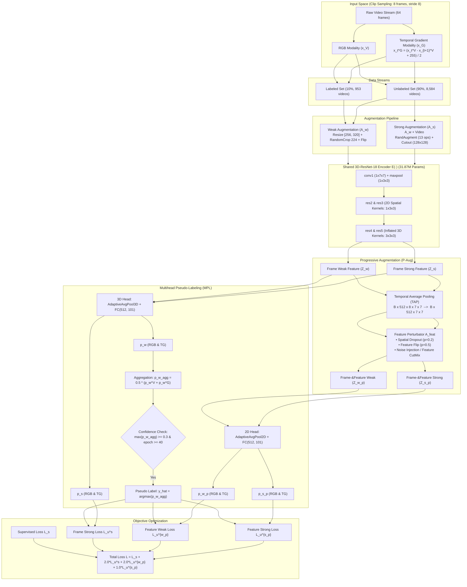

# Technical Methodology: Semi-Supervised Action Recognition with FixMatch and $F^2$-FixMatch

## 1. Executive Summary & Problem Formulation

Video annotation is significantly more labor-intensive and costly than static image annotation, as it requires annotating spatio-temporal boundaries and temporal dynamics across dozens of frames. Conversely, unlabelled video data is abundant. The core objective of this project is to solve the following problem statement:

> **Problem Statement**: *Labels for video are expensive; unlabelled video is free. Train an action classifier with only 10% of UCF-101 labels using consistency-based pseudo-labelling.*

To establish rigorous scientific validation, we implement, benchmark, and compare four developmental tiers:
1. **Supervised Baseline (10% Labels Only)**: Trained strictly on the 953 annotated videos without access to unlabeled data.
2. **Standard FixMatch Baseline**: Adapting image FixMatch to video with spatial weak/strong augmentations (RandAugment + Cutout) and confidence thresholding ($\tau = 0.3$).
3. **$F^2$-FixMatch (Full Framework)**: Introducing bi-modal inputs (RGB + Temporal Gradient), **Progressive Augmentation (P-Aug)** across frames and deep latent features, and **Multihead Pseudo-Labeling (MPL)**.
4. **Fully Supervised Upper Bound (Oracle, 100% Labels)**: Theoretical ceiling trained on all 9,537 training videos.

---

## 2. End-to-End System Architecture



---

## 3. Detailed Component Specifications

### 3.1 3D-ResNet-18 Backbone Architecture

The network adopts the inflated 3D-ResNet-18 architecture detailed in Table 2 of the $F^2$-FixMatch paper.

| Stage | Operations & Kernel Configuration | Stride $(t, h, w)$ | Output Dimension ($C \times T \times H \times W$) | Kernel Nature |
| :--- | :--- | :---: | :---: | :---: |
| **Input** | Raw video clip (8 frames) | — | $3 \times 8 \times 224 \times 224$ | Spatio-temporal |
| **conv1** | $1 \times 7 \times 7, 64$, BatchNorm3d, ReLU | $(1, 2, 2)$ | $64 \times 8 \times 112 \times 112$ | 2D Spatial Only |
| **pool1** | $1 \times 3 \times 3$ MaxPool3d | $(1, 2, 2)$ | $64 \times 8 \times 56 \times 56$ | 2D Spatial Only |
| **res2** | $\begin{bmatrix} 1 \times 3 \times 3, 64 \\ 1 \times 3 \times 3, 64 \end{bmatrix} \times 2$ | $(1, 1, 1)$ | $64 \times 8 \times 56 \times 56$ | 2D Spatial Only |
| **res3** | $\begin{bmatrix} 1 \times 3 \times 3, 128 \\ 1 \times 3 \times 3, 128 \end{bmatrix} \times 2$ | $(1, 2, 2)$ | $128 \times 8 \times 28 \times 28$ | 2D Spatial Only |
| **res4** | $\begin{bmatrix} 3 \times 3 \times 3, 256 \\ 3 \times 3 \times 3, 256 \end{bmatrix} \times 2$ | $(1, 2, 2)$ | $256 \times 8 \times 14 \times 14$ | **Inflated 3D Spatio-Temporal** |
| **res5** | $\begin{bmatrix} 3 \times 3 \times 3, 512 \\ 3 \times 3 \times 3, 512 \end{bmatrix} \times 2$ | $(1, 2, 2)$ | $512 \times 8 \times 7 \times 7$ | **Inflated 3D Spatio-Temporal** |
| **3D Head**| `AdaptiveAvgPool3d((1, 1, 1))` $\to$ `Dropout(0.5)` $\to$ `Linear(512, 101)` | — | $101$ logits | Global Classification |
| **2D Head**| `AdaptiveAvgPool2d((1, 1))` $\to$ `Dropout(0.5)` $\to$ `Linear(512, 101)` (shared FC) | — | $101$ logits | TAP Feature Classification |

> [!IMPORTANT]
> **Zero Temporal Downsampling**: Notice that temporal stride is strictly $1$ across every single layer from conv1 to res5. This preserves temporal fidelity and allows modeling motion dynamics without premature temporal compression.

---

### 3.2 Dynamic Temporal Gradient (TG) Modality

To overcome appearance bias and encode pure motion dynamics without the heavy computational burden of optical flow (e.g., TV-$L^1$ or Farnebäck), we integrate the **Temporal Gradient (TG)** modality:

$$x_t^G = \frac{x_t^V - x_{t+1}^V + 255}{2}$$

where $x_t^V$ is the current RGB frame and $x_{t+1}^V$ is the consecutive frame.

* **On-the-Fly Generation**: Rather than extracting and saving millions of JPEG files to disk (which would consume over 50 GB of storage and cause massive disk I/O bottlenecks), `dataset.py` computes $x^G$ dynamically in RAM using fast vector operations when reading frames.
* **Single Shared Encoder**: Rather than maintaining two separate networks for RGB and TG, a single 3D-ResNet-18 extracts representations for both modalities. This forces the encoder to learn features invariant across appearance and motion.

---

### 3.3 Data Augmentation Hierarchy

```
Input Video (8 Frames, 240x320)
       │
       ├───────────────────────────────────────────────┐
       ▼                                               ▼
[Weak Augmentation Stream]                     [Strong Augmentation Stream]
1. Sample shorter side in [256, 320]           1. Video-level RandAugment (N=2, M=10)
2. RandomCrop to (224, 224)                       - 13 Operations applied identically
3. Random Horizontal Flip (p=0.5)                   across all 8 frames for temporal sync
4. ImageNet Normalization                      2. Video Cutout
                                                  - 128x128 square patch zeroed across
                                                    all 8 frames at identical coordinates
                                               3. Weak Spatial Pipeline (Resize/Crop/Flip)
                                               4. ImageNet Normalization
```

The 13 operations in Video RandAugment are:
1. `AutoContrast`
2. `Equalize`
3. `Rotate` ($\pm 30^\circ$)
4. `Solarize` ($[0, 256]$)
5. `Color` ($[0.05, 0.95]$)
6. `Contrast` ($[0.05, 0.95]$)
7. `Brightness` ($[0.05, 0.95]$)
8. `Sharpness` ($[0.05, 0.95]$)
9. `ShearX` ($\pm 0.3$)
10. `ShearY` ($\pm 0.3$)
11. `TranslateX` ($\pm 30\%$)
12. `TranslateY` ($\pm 30\%$)
13. `Posterize` ($[4, 8]$ bits)

---

### 3.4 Progressive Augmentation (P-Aug)

Standard FixMatch applies perturbations only at the raw pixel level ($A_w^{\text{frame}}, A_s^{\text{frame}}$). In video, pixel perturbations primarily alter local texture and scale, failing to capture abstract motion transitions.

P-Aug extends augmentation to the latent feature space:
1. **Temporal Average Pooling (TAP)**: Given high-level feature $Z \in \mathbb{R}^{B \times 512 \times 8 \times 7 \times 7}$, average across the temporal dimension $T=8$:
   $$\text{TAP}(Z) = \frac{1}{T} \sum_{t=1}^T Z_t \in \mathbb{R}^{B \times 512 \times 7 \times 7}$$
2. **Latent Perturbations ($A_{\text{feat}}$)**:
   * **Spatial Dropout**: Channel-wise 2D dropout ($p=0.2$) zeroes feature maps to enforce feature diversity.
   * **Feature Flipping**: Random horizontal feature reflection with probability $p=0.5$.
   * **Noise Injection (Feature CutMix)**: Randomly copies a $2 \times 2$ or $3 \times 3$ feature patch from another sample in the mini-batch.

This produces four distinct feature representations per video:
* $Z_w$: Frame-level Weak feature
* $Z_s$: Frame-level Strong feature
* $Z_{w\_p}$: Frame-Weak, Feature-Perturbed feature
* $Z_{s\_p}$: Frame-Strong, Feature-Perturbed feature

---

### 3.5 Multihead Pseudo-Labeling (MPL) & Loss Formulations

For mini-batch with $B_l$ labeled samples and $B_u = \mu B_l$ unlabeled samples ($\mu = 4$):

> [!NOTE]
> **Batch Size & Unlabeled Ratio ($\mu$) in the Literature:**
> * **Image FixMatch (Sohn et al., NeurIPS 2020, Section 4 & Appendix B.5, Fig. 5a)**: Defaults to $\mu = 7$ and $B_l = 64$ (total unlabeled batch $B_u = 448$). The authors' ablation shows that increasing the ratio of unlabeled data from $\mu = 1$ to $\mu = 7$ steadily lowers the error rate by up to 10%–15%.
> * **$F^2$-FixMatch for Video (Tu et al., ACM TOMM 2025, Section 4.2, p. 11–12)**: Adapts this ratio for 3D video, setting $\mu = 4$ for UCF-101 and $\mu = 1$ for HMDB-51:
>   > *"The mini-batch size per GPU is set as four clips for labeled data and $4 \times \mu$ clips for unlabeled data... In the training phase, the hyper-parameter $\mu$ in Section 3.2 is set as 4 for UCF-101 and 1 for HMDB-51. We train the whole model with an initial learning rate of 0.2 on 2 GPUs and adopt gradient accumulation to imitate a larger mini-batch size... We use synchronous batch normalization (BN) to compute the BN statistics within the clips across all GPUs."*
> * **Hardware Memory Scaling**: In 3D video, each clip consists of 8 spatial frames ($8 \times 224 \times 224 \times 3$). Feeding bi-modal weak/strong streams across labeled and unlabeled batches requires holding dozens of dense 5D activation volumes in VRAM. On consumer hardware (e.g. 6GB RTX 4050), $B_l = 4, \mu = 4$ ($B_u = 16$) hits the sweet spot between full GPU memory utilization and robust consistency learning.

#### 1. Supervised Loss ($\mathcal{L}_s$)
Computed on weakly augmented labeled samples across both modalities:
$$\mathcal{L}_s^V = \frac{1}{B_l} \sum_{k=1}^{B_l} H\left(y_k, F(A_w(x_k^V))\right)$$
$$\mathcal{L}_s^G = \frac{1}{B_l} \sum_{k=1}^{B_l} H\left(y_k, F(A_w(x_k^G))\right)$$
$$\mathcal{L}_s = \frac{1}{2}\left(\mathcal{L}_s^V + \mathcal{L}_s^G\right)$$

#### 2. Multihead Pseudo-Label Generation
For unlabeled sample $u$, calculate weak class distributions:
$$p_w^V = \text{Softmax}\left(\text{FC}\left(\text{AvgPool}(Z_w^V)\right)\right), \quad p_w^G = \text{Softmax}\left(\text{FC}\left(\text{AvgPool}(Z_w^G)\right)\right)$$
Fuse both views:
$$p_w^{agg} = \frac{p_w^V + p_w^G}{2}$$
Filter confident set $C$ using threshold $\tau = 0.3$:
$$C = \left\{ i \in [1, B_u] : \max(p_{w, i}^{agg}) \ge \tau \right\}$$
Pseudo-label:
$$\hat{y}_i = \arg\max(p_{w, i}^{agg})$$

> [!NOTE]
> **Why is $\tau = 0.3$ while image FixMatch uses $\tau = 0.95$?**
> In 101-class action classification with only 10% labels, the uniform prior probability is $1/101 \approx 0.0099$. A model prediction of $0.30$ represents over **30× higher confidence than random chance**. Setting $\tau = 0.95$ on video from scratch results in near-zero samples passing early on, starving the model of unsupervised gradients.

#### 3. Unsupervised Consistency Losses
Enforce consistency across the three perturbed streams:
$$\mathcal{L}_u^s = \frac{1}{2 B_u} \sum_{i \in C} \left[ H(\hat{y}_i, p_{s, i}^V) + H(\hat{y}_i, p_{s, i}^G) \right]$$
$$\mathcal{L}_u^{w\_p} = \frac{1}{2 B_u} \sum_{i \in C} \left[ H(\hat{y}_i, p_{w\_p, i}^V) + H(\hat{y}_i, p_{w\_p, i}^G) \right]$$
$$\mathcal{L}_u^{s\_p} = \frac{1}{2 B_u} \sum_{i \in C} \left[ H(\hat{y}_i, p_{s\_p, i}^V) + H(\hat{y}_i, p_{s\_p, i}^G) \right]$$

#### 4. Total Objective Function
$$\mathcal{L} = \mathcal{L}_s + \alpha \mathcal{L}_u^s + \beta \mathcal{L}_u^{w\_p} + \gamma \mathcal{L}_u^{s\_p}$$
where $\alpha = 2.0, \beta = 2.0, \gamma = 1.0$.

For standard FixMatch (RGB only):
$$\mathcal{L}_{\text{FixMatch}} = \mathcal{L}_s + \lambda_u \mathcal{L}_u, \quad \lambda_u = 1.0$$

---

## 4. Training Schedule & The 40-Epoch Warmup Dynamics

```
Epoch 0          Epoch 40                                              Epoch 220
  │                  │                                                     │
  ▼                  ▼                                                     ▼
┌─────────────────────┬─────────────────────────────────────────────────────┐
│    WARM-UP PHASE    │               ACTIVE FIXMATCH / F²-FIXMATCH         │
│  (Labeled Only)     │             (Labeled + 8,584 Unlabeled Samples)     │
│                     │                                                     │
│ • Loss_U = 0.0000   │ • Pseudo-labeling engaged (tau = 0.3)               │
│ • Mask Rate = 0.0%  │ • Mask Rate climbs: 25% -> 55% -> 80%+              │
│ • Supervised L_s    │ • Total Loss = L_s + alpha*L_u^s + beta*L_u^{w_p}   │
│ • Linear Warmup LR  │ • Cosine Annealing Decay LR                         │
└─────────────────────┴─────────────────────────────────────────────────────┘
```

* **Warmup Rationale**: Random initial weights yield arbitrary pseudo-labels. Enforcing consistency on noise leads to severe confirmation bias and parameter divergence. The 40-epoch supervised warmup establishes semantic representations before unlabeled data is leveraged.
* **Optimization Details**:
  * Optimizer: Stochastic Gradient Descent (SGD) with momentum $\beta = 0.9$, weight decay $\lambda = 10^{-4}$.
  * Initial learning rate: $\eta_0 = 0.2$.
  * Learning rate schedule: Linear warm-up for initial epochs, followed by Cosine Annealing Decay down to $10^{-5}$:
    $$\eta(t) = \frac{\eta_0}{2} \left(1 + \cos\left(\frac{t - T_{\text{warm}}}{T_{\text{total}} - T_{\text{warm}}} \pi\right)\right)$$

---

## 5. Official Benchmark Evaluation Protocol (10 Clips $\times$ 3 Crops)

To accurately replicate published benchmark numbers, test evaluation follows the protocol defined in LTG, MvPL, and $F^2$-FixMatch:
1. **10 Uniform Temporal Clips**: Uniformly samples 10 starting points spanning the full video duration.
2. **3 Spatial Crops per Clip**: Shorter side resized to 256; crops extracted at left/top, center, and right/bottom at $256 \times 256$ (or $224 \times 224$).
3. **Multi-View Ensembling**: Yields $10 \times 3 = 30$ views per video. Softmax probability distributions across all 30 views are averaged:
   $$\bar{P}(y \mid X) = \frac{1}{30} \sum_{v=1}^{30} \text{Softmax}\left(F\left(x^{(v)}\right)\right)$$
4. Final prediction: $\hat{y}_{\text{video}} = \arg\max \bar{P}(y \mid X)$. Only RGB clips are used at test time (no additional TG computation required).

---

## 6. Target Accuracies & Comparative Roadmap

| Framework | Labeled Set | Unlabeled Set | Modality | Key Mechanisms | Target Top-1 Acc | Target Top-5 Acc |
| :--- | :---: | :---: | :---: | :--- | :---: | :---: |
| **Supervised Baseline** | 10% (953) | None | RGB | Labeled cross-entropy only | **29.84%** *(Achieved)* | **54.64%** *(Achieved)* |
| **Pseudo-Label (ICMLW '13)** | 10% (953) | 90% (8,584) | RGB | Hard pseudo-labeling | 24.7% | — |
| **MeanTeacher (NIPS '17)** | 10% (953) | 90% (8,584) | RGB | EMA teacher weights | 25.6% | — |
| **$S^4L$ (ICCV '19)** | 10% (953) | 90% (8,584) | RGB | Self-supervised auxiliary | 29.1% | — |
| **FixMatch Baseline** | 10% (953) | 90% (8,584) | RGB | $\tau=0.3$ + RandAugment + Cutout | **36.03%** *(Achieved)* <br> *(Paper Table 5: 51.7%)* | **64.68%** *(Achieved)* |
| **$F^2$-FixMatch (A1 Ablation)**| 10% (953) | 90% (8,584) | RGB + TG | Bi-modal Frame W/S-Aug ($Z_w, Z_s$) | **67.9%** (Table 4) | ~87.4% |
| **$F^2$-FixMatch (Full)** | 10% (953) | 90% (8,584) | RGB + TG | P-Aug ($Z_w, Z_s, Z_{w\_p}, Z_{s\_p}$) + MPL | **71.1%** (Table 3) | **90.3%** |
| **Supervised Upper Bound** | 100% (9,537)| None | RGB | All UCF-101 annotations | **~81% – 84%** | ~95.8% |
