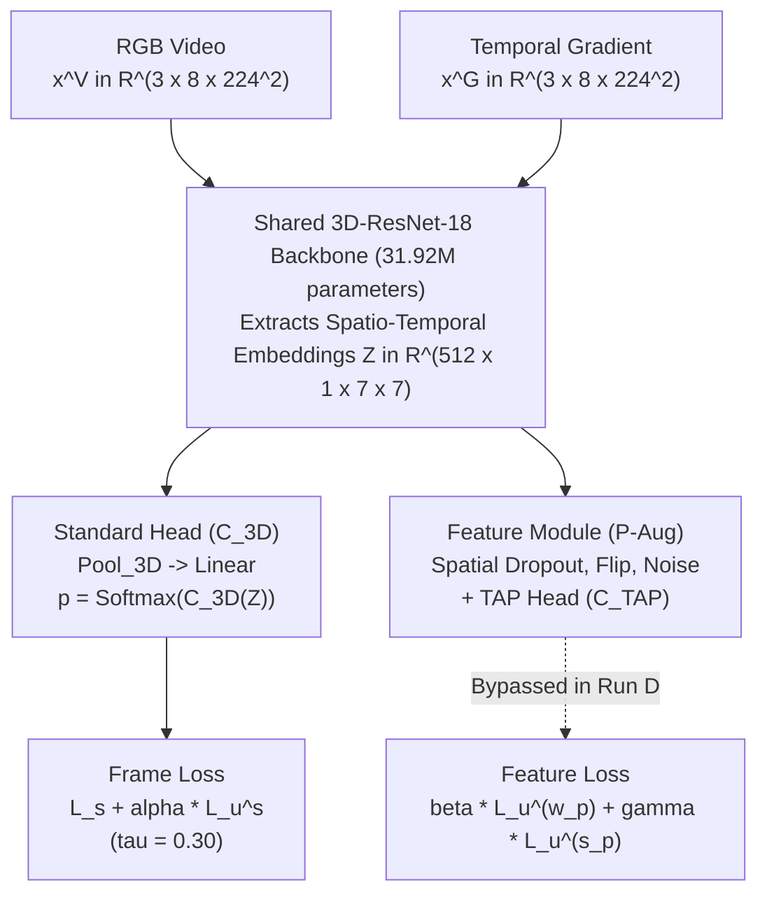

# Tables & Figures (`docs/report.tex` / `docs/report.pdf`)

Exact tables and figure from [**`docs/report.tex`**](report.tex).

---

## Figure 1: Overview of the Dual-Stream Video SSL Architecture

*Caption: Overview of the Dual-Stream Video SSL Architecture. In Run D, auxiliary TAP passes and feature losses ($\beta, \gamma$) are bypassed, isolating the dual-stream package.*

---

## Table 1: The 5-Rung Experimental Ladder on UCF-101 Split 1

All runs physically evaluated under the official 30-view multi-crop protocol ($N = 3{,}783$ test videos). Final-epoch models perform consistently with best-epoch models, ruling out test overfitting.

| Run | Modality | Loss Weights | Description | Best Top-1 | Final Top-1 | Top-5 | $\Delta$ vs. 10% Sup | $\Delta$ vs. FixMatch |
| :---: | :---: | :---: | :--- | :---: | :---: | :---: | :---: | :---: |
| **A** | RGB | Supervised | 100% Supervised Oracle | **72.91%** | — | 90.06% | +41.59% | +34.42% |
| **B** | RGB | Supervised | 10% Supervised Baseline | 31.32% | 30.80% | 54.11% | *Reference* | -7.17% |
| **C** | RGB | $\lambda_u=2.0, \tau=0.30$ | FixMatch RGB Baseline | 38.49% | 38.88% | 64.00% | +7.17% | *Reference* |
| **D** | **RGB + TG** | $\beta=0, \gamma=0$ | **Dual-Stream Control** | **59.03%** | **59.37%** | **82.90%** | **+27.71%** | **+20.54%** |
| **F** | **RGB + TG** | $\beta=2, \gamma=1$ | Full $F^2$-FixMatch | **59.90%** | **60.35%** | **83.32%** | **+28.58%** | **+21.41%** |

---

## Table 2: Empirical Comparison of Feature-Level Consistency Gains

Our physical reproduction vs. Tu et al. published ablations (Table 4) on UCF-101 Split 1.

| Configuration / Metric | Our Reproduction | Tu et al. Published |
| :--- | :---: | :---: |
| Single-Stream Baseline | 38.49% (Run C) | 38.40% |
| Frame Dual-Stream ($\beta=0, \gamma=0$) | 59.03% (Run D) | 67.90% (A1) |
| Full $F^2$-FixMatch | 59.90% (Run F) | 71.10% (A4) |
| **Dual-Stream Gain ($\Delta_{\text{dual}}$)** | **+20.54 pts** (95.9%) | **+29.50 pts** (90.2%) |
| **Feature Module Delta ($\Delta_{\text{feat}}$)** | **+0.87 pts** (4.1%) | **+3.20 pts** (9.8%) |
| Total SSL Gain ($\Delta_{\text{total}}$) | +21.41 pts (100.0%) | +32.70 pts (100.0%) |
