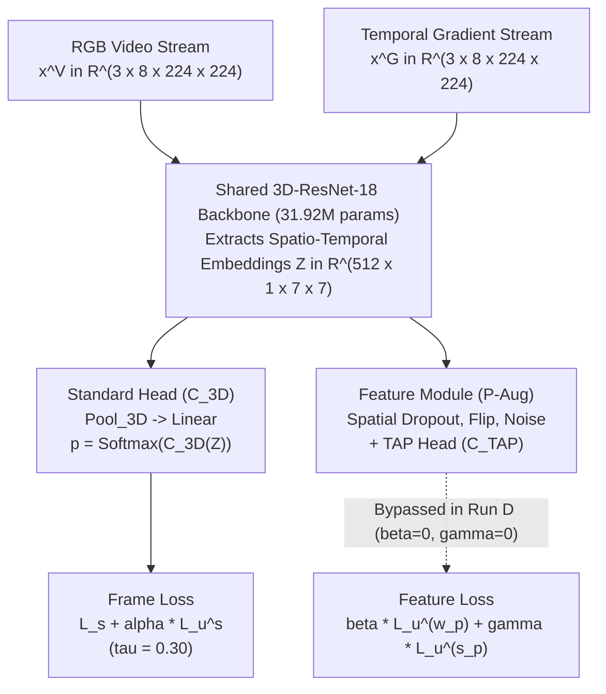
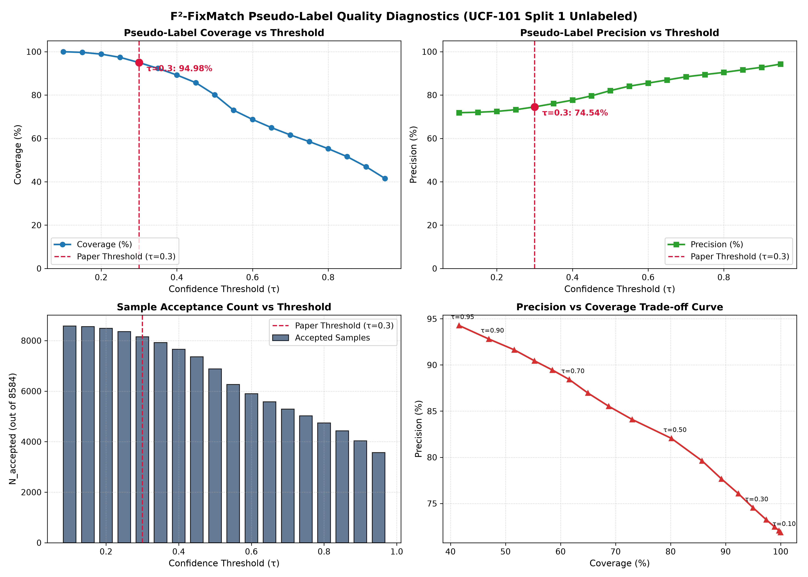

# Tables & Figures Reference (`docs/report.pdf`)

All tables and figures compiled from [**`docs/report.tex`**](report.tex), [**`README.md`**](../README.md), and [**`RESULTS.md`**](../RESULTS.md) on **UCF-101 Split 1** (3D-ResNet-18, 31.92M parameters, matched 30-view protocol, $N = 3{,}783$ test videos).

---

## Figures

### Figure 1: Dual-Stream Video SSL Architecture Overview



*(In **Run D**, auxiliary TAP passes and feature losses $\beta, \gamma$ are completely bypassed, isolating the dual-stream package.)*

---

### Figure 2: Pseudo-Label Precision & Unlabeled Coverage Curves



*Source: [`results/pseudolabel_f2/pseudolabel_curves.png`](../results/pseudolabel_f2/pseudolabel_curves.png) (evaluated across $N = 8{,}584$ unlabeled UCF-101 Split 1 training videos).*

---

## Tables

### Table 1: The 5-Rung Experimental Ladder on UCF-101 Split 1

All models evaluated under the official **30-view multi-crop protocol** ($10\text{ temporal clips} \times 3\text{ spatial crops}$ at $256 \times 256$, $N = 3{,}783$ test videos).

| Run | Modality | Loss Weights ($\beta, \gamma$) | Description | Best Top-1 (%) | Final Top-1 (%) | Top-5 (%) | $\Delta$ vs. 10% Sup | $\Delta$ vs. FixMatch |
| :---: | :---: | :---: | :--- | :---: | :---: | :---: | :---: | :---: |
| **A** | RGB | Supervised | 100% Supervised Oracle | **72.91%** | — | **90.06%** | +41.59% | +34.42% |
| **B** | RGB | Supervised | 10% Supervised Baseline | 31.32% | 30.80% | 54.11% | *Reference* | -7.17% |
| **C** | RGB | $\lambda_u=2.0, \tau=0.30$ | FixMatch RGB Baseline | 38.49% | 38.88% | 64.00% | +7.17% | *Reference* |
| **D** | **RGB + TG** | $\beta=0, \gamma=0$ | **Dual-Stream Control** | **59.03%** | **59.37%** | **82.90%** | **+27.71%** | **+20.54%** |
| **F** | **RGB + TG** | $\beta=2, \gamma=1$ | Full $F^2$-FixMatch | **59.90%** | **60.35%** | **83.32%** | **+28.58%** | **+21.41%** |

```text
Top-1 Accuracy Progression (30-View Matched Protocol):
  Run B (Supervised 10%):     [███████████                 ] 31.32%
  Run C (FixMatch RGB):       [█████████████               ] 38.49% (+7.17% over 10% Sup)
  Run D (Dual-Stream RGB+TG): [█████████████████████       ] 59.03% (+20.54% over FixMatch RGB)
  Run F (Full F²-FixMatch):   [█████████████████████       ] 59.90% (+0.87% over Run D | +21.41% over Run C)
  Run A (Supervised 100%):    [██████████████████████████  ] 72.91% (Oracle ceiling)
```

---

### Table 2: Empirical Comparison of Feature-Level Consistency Gains

Direct side-by-side comparison between our physical reproduction and Tu et al. published ablations (Table 4) on UCF-101 Split 1:

| Configuration / Metric | Our Reproduction | Tu et al. Published (Table 4) |
| :--- | :---: | :---: |
| **Single-Stream Baseline** | 38.49% (Run C) | 38.40% |
| **Frame Dual-Stream ($\beta=0, \gamma=0$)** | 59.03% (Run D) | 67.90% (A1) |
| **Full $F^2$-FixMatch ($\beta=2, \gamma=1$)** | 59.90% (Run F) | 71.10% (A4) |
| **Dual-Stream Gain ($\Delta_{\text{dual}}$)** | **+20.54 pts** (95.9%) | **+29.50 pts** (90.2%) |
| **Feature Module Delta ($\Delta_{\text{feat}}$)** | **+0.87 pts** (4.1%) | **+3.20 pts** (9.8%) |
| **Total SSL Gain ($\Delta_{\text{total}}$)** | **+21.41 pts** (100.0%) | **+32.70 pts** (100.0%) |

* **Binomial Evaluation Margin ($N = 3{,}783, p \approx 0.60$)**: $\mathrm{SE} \approx 0.80\% \implies \text{95\% Margin} = \pm 1.56\%$ ($+0.87\% \approx 33$ test videos).
* **Computational Trade-Off**: Bypassing auxiliary TAP passes in Run D reduces per-epoch training time by $\sim 15\%$ (~4.0 vs. ~4.7 min/epoch) and lowers peak VRAM.

---

### Table 3: Confidence Threshold Ablation ($\tau = 0.95$ vs. $\tau = 0.30$)

Evaluated on FixMatch RGB with pseudo-label statistics measured across $N = 8{,}584$ unlabeled training videos:

| Setting | Threshold ($\tau$) | Pseudo-Label Precision | Unlabeled Coverage | Top-1 (30-View) | Top-5 |
| :--- | :---: | :---: | :---: | :---: | :---: |
| **FixMatch RGB ($\tau = 0.95$)** | 0.95 | **94.28%** | 41.54% (3,566 / 8,584) | **36.93%** (Final: **37.09%**) | 63.81% |
| **FixMatch RGB ($\tau = 0.30$)** | 0.30 | 74.54% | **94.98%** (8,153 / 8,584) | **38.49%** (Final: **38.88%**) | 64.00% |
| **Supervised 10% Reference** | None | — | — | 31.32% (Final: 30.80%) | 54.11% |

---

### Table 4: Cross-Modal BatchNorm Recalibration (PreciseBN Diagnostic)

Frozen-weight population statistics re-estimation using clean RGB training clips (`recalibrate_bn.py`, $< 2\text{ min}$, 64/64 parameters bitwise identical):

| Model | Pre-Recalibration (30-View) | Post-PreciseBN (30-View) | Gain | Weight Changes |
| :--- | :---: | :---: | :---: | :---: |
| **Full $F^2$-FixMatch (Run F)** | 59.90% | **62.81%** | **+2.91 pts** | 0 (bitwise identical) |
| **Dual-Stream Control (Run D)** | 59.03% | **61.06%** | **+2.03 pts** | 0 (bitwise identical) |

---

### Table 5: Hardware & Wall-Clock Training Budget (NVIDIA RTX A5000, 24 GB VRAM)

| Model / Task | Epochs | Batch Size ($B_l + B_u$) | Accum Steps | Runtime | Throughput |
| :--- | :---: | :---: | :---: | :---: | :---: |
| **Run A (100% Supervised)** | 120 | 4 | 2 | ~4.2 hrs | ~2.1 min / epoch |
| **Run B (10% Supervised)** | 120 | 4 | 2 | ~0.8 hrs | ~0.4 min / epoch |
| **Run C (FixMatch $\tau=0.30$)** | 220 | 4 + 16 | 2 | ~7.8 hrs | ~2.1 min / epoch |
| **Run C-$\tau$ (FixMatch $\tau=0.95$)** | 220 | 4 + 16 | 2 | ~7.8 hrs | ~2.1 min / epoch |
| **Run D (Dual-Stream Control)** | 220 | 4 + 16 (RGB+TG) | 2 | ~11.2 hrs | ~3.0 min / epoch |
| **Run F (Full $F^2$-FixMatch)** | 220 | 4 + 16 (RGB+TG) | 2 | ~17.3 hrs | ~4.7 min / epoch |
| **PreciseBN Recalibration** | 200 batches | 4 | — | ~45 sec | ~4.4 batch / sec |
| **Pseudo-Label Diagnostic** | 8,584 videos | 8 | — | ~12 min | ~11.9 video / sec |
| **30-View Full Evaluation** | 3,783 videos | 8 | — | ~30 min | ~2.1 video / sec |
